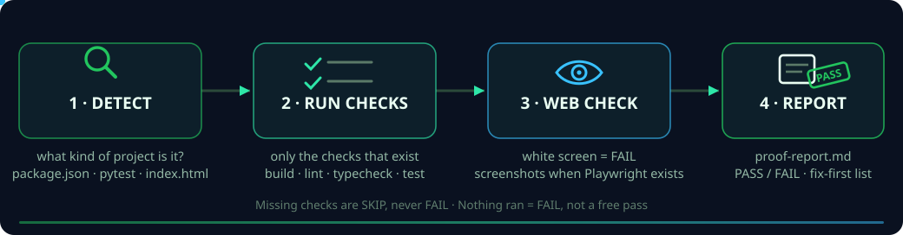

<div align="center">




<br/>

[](proof.py)
[](#-guarantees)
[](#-use-it-from-an-agent)
[](#-tests)
[](LICENSE)

</div>

AI coding agents finish a task and announce success — while the build
is broken, a test fails, or the page is a white screen. The human
re-checks everything by hand.

`proof check` runs the checks the project *already has*, looks at the
web UI the way a user would hit it, deduplicates the errors, and
writes **one compact PASS/FAIL report** (`proof-report.md`) that the
agent can read, fix from, and re-run — until it can honestly say
"done", receipt attached.


## 🛡️ Guarantees

- **Missing is SKIP, never FAIL.** No `test` script? That check does
  not exist — it is not a failure.
- **Stdlib-only core.** No pip installs, no API keys. If Playwright
  happens to be installed, web checks also capture desktop + mobile
  screenshots and console errors; if not, that check is an honest
  SKIP — never a hard dependency.
- **Nothing ran = not proof.** A project where zero checks executed
  gets a FAIL verdict, not a free pass.


## 🚀 Quick start

```bash
python3 proof.py check ./my-project                  # → ./my-project/proof-report.md
python3 proof.py check ./my-project --out report.md
python3 proof.py check ./my-project --url http://localhost:3000
echo $?   # 0 = PASS, 1 = FAIL
```


## ⚙️ How it works

<div align="center">

</div>

## 🔍 What it checks

| Check | When | Notes |
|---|---|---|
| `npm run build / lint / typecheck / test` | the script exists in `package.json` | only existing scripts run; 120s timeout each |
| `pytest -q` | Python tests/config present | SKIP if pytest missing or collects nothing |
| web page (white-screen) | `--url` given, or a static `index.html` exists | HTTP ≥ 400 or an empty/near-empty page = FAIL; missing `<title>` = warning |
| web screenshots (playwright) | `--url` given **and** playwright installed | desktop + mobile screenshots in `proof-screenshots/`; console errors = FAIL; otherwise SKIP |

Failures are **deduplicated**: the same error line repeated 40 times
appears once, as `×40`, so the report stays short enough for an agent
to read in one pass — and ends with a **"Fix these first"** list.

## 📋 Example report (excerpt)

```markdown
## Verdict: FAIL

| Check | Status | Time | Detail |
|---|---|---|---|
| npm run build | FAIL | 0.8s | exit 1 |
| web page (white-screen) | PASS | 0.0s | 1,240 chars of visible text (index.html) |

## Fix these first
1. **npm run build**: Error: deliberate build failure in fixture
```


## 🤖 Use it from an agent

**MCP (stdio)** — one tool, `proof_check` (`project_dir`, optional `url`):

```bash
python3 proof.py mcp
```

```json
{ "command": "python3", "args": ["/path/to/proof.py", "mcp"] }
```

**Skill** — see [SKILL.md](SKILL.md): *never report done without a
proof check PASS; if FAIL, fix and re-run.*


## 🧪 Tests

```bash
python3 -m unittest   # unit tests + the planted-error acceptance tests
```

The suite includes the three planted-error fixtures in `fixtures/`:
a Node project whose build deliberately fails (must FAIL, naming the
build), a static page with an empty body (must FAIL, white screen
detected), and a healthy static site (must PASS).

Real-project evidence: [`real-project-report-keyscope.md`](real-project-report-keyscope.md) —
proof-cli run against the KeyScope project, verdict PASS (screenshots
SKIP, Playwright not installed — reported honestly, as designed).

## 🗺️ Roadmap

- v0.2: overflow/layout heuristics from screenshots, `--json` output,
  git-diff mode (check only what changed)
- Later: GitHub Action wrapper, per-agent badges, flaky-check history

## 📄 License

MIT — see [LICENSE](LICENSE).

<div align="center">

</div>
